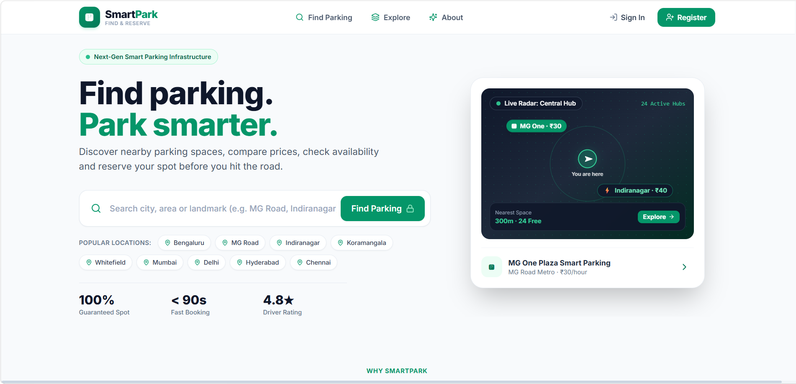
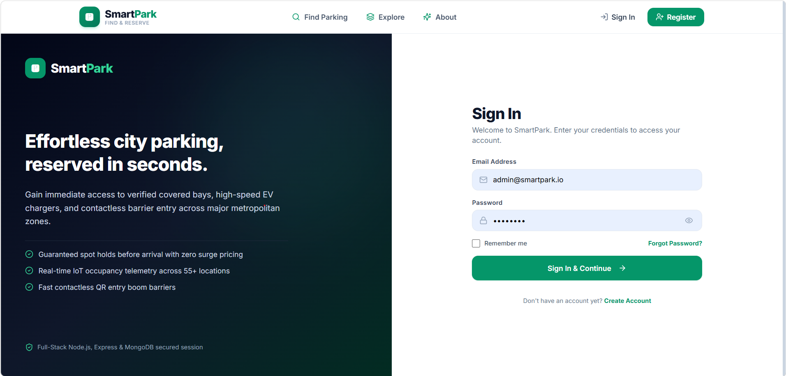
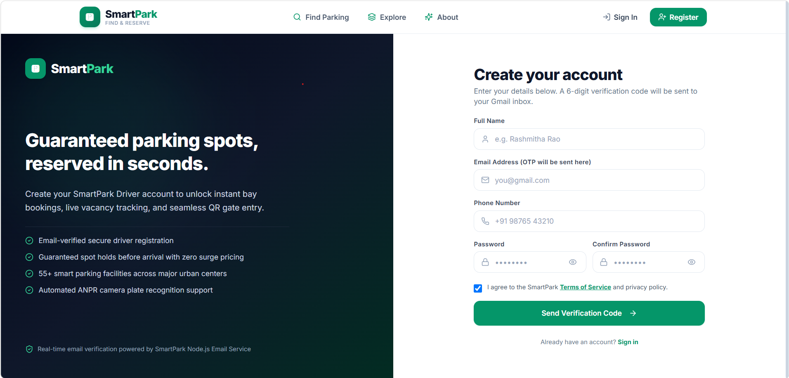
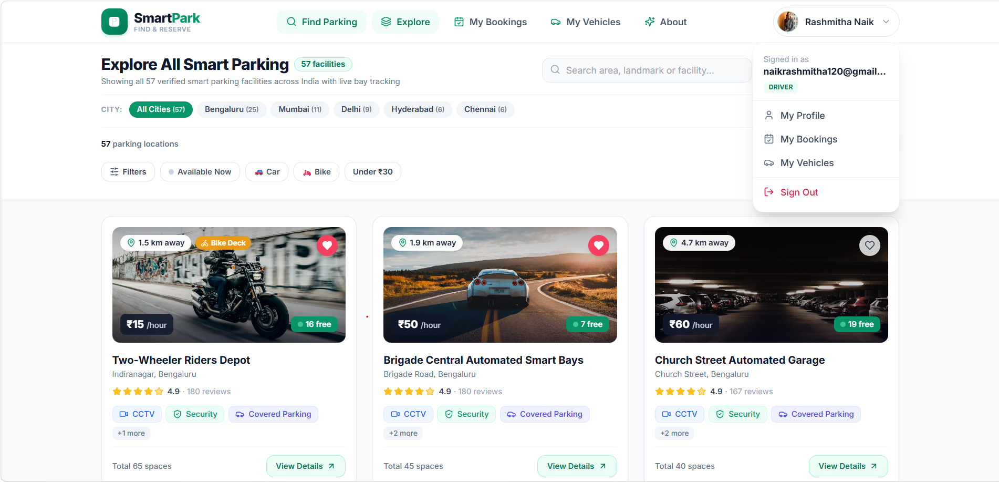
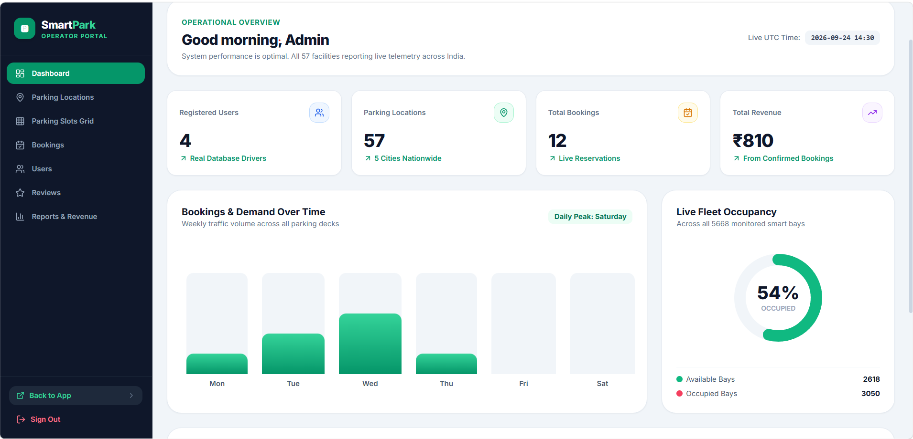

# Smart Parking System

A modern full-stack web application for real-time parking discovery, bay reservation, and facility management. It solves urban parking congestion, reduces fuel consumption, and eliminates manual ticketing by providing drivers with live slot availability, turn-by-turn navigation, and instant digital QR passes.

## About the Project

Finding convenient and secure parking in crowded urban areas is a persistent challenge that causes traffic congestion, unnecessary emissions, and driver frustration. The **Smart Parking System** provides an end-to-end digital solution connecting drivers with smart parking facilities.

**Purpose:** 
To modernize urban mobility and parking operations through automated slot tracking, verified bookings, dynamic fare calculation, and contactless entry/exit passes.
- **Target Users:**
  - **Drivers & Commuters:** Looking for guaranteed, nearby parking for cars or two-wheelers with transparent rates and easy navigation.
  - **Facility Operators & Administrators:** Needing real-time bay occupancy telemetry, slot status toggling, reservation logs, and revenue analytics.
- **How It Works:**
  1. Drivers explore parking facilities via an interactive map or search filters (location, price, amenities, vehicle type).
  2. Users select arrival time, booking duration, and vehicle details to calculate dynamic pricing and secure a reserved bay.
  3. Upon confirmation, a digital QR pass is generated and sent via email for seamless, contactless check-in.
  4. Facility operators monitor live bay occupancy, manage slot statuses, and track daily/monthly revenues through a dedicated Admin Dashboard.

## Features

- **User authentication:** Secure user registration with 6-digit email OTP verification, password hashing, and role-based access control (Driver and Operator/Admin).
- **Responsive user interface:** Sleek, modern interface built with React and Tailwind CSS, optimized for desktop, tablet, and mobile displays.
- **Search and filtering:** Search parking facilities by city, area, price range, vehicle category (Car/Bike), and amenities (EV charging, covered spots, 24/7 security).
- **Data management:** Centralized database operations for managing user profiles, registered vehicles, parking lots, real-time slot occupancy, reservations, and driver reviews.
- **Interactive Map Integration:** Real-time Leaflet map with standard, satellite hybrid, and terrain views, live occupancy markers, and direct Google Maps directions.
- **Digital QR Code Passes:** Instant contactless entrance pass generation upon booking confirmation with automated email receipt dispatch via Nodemailer.
- **Admin Operator Dashboard:** Live occupancy telemetry graphs, slot sensor management (Available, Occupied, EV Reserved, Maintenance), booking lists, and revenue reports.
- **Vehicle Management:** User portal to save and manage multiple personal vehicles for fast checkout.

## Technologies Used

- **Frontend:** React.js, HTML5, CSS3, JavaScript (ES6+), Tailwind CSS, Vite, Leaflet, Lucide Icons
- **Backend:** Node.js, Express.js, Nodemailer (Email/OTP service)
- **Database:** MongoDB (Mongoose ODM)
- **Tools:** Git, GitHub, VS Code, Postman

## Screenshots








## Project Structure

```text
SmartParking/
├── screenshots/           # Application screenshots and previews
│   └── homepage.png
├── server/                # Backend API (Node.js & Express)
│   ├── models/            # Mongoose schemas (User, Vehicle, Parking, Booking)
│   ├── seed.js            # Initial database seeder script
│   └── server.js          # REST API endpoints, auth, and email delivery
├── src/                   # Frontend client (React & Tailwind CSS)
│   ├── assets/            # Static assets and media files
│   ├── components/        # Reusable UI components (Navbar, Button, Cards, Modals)
│   ├── context/           # React Context providers (Auth, Vehicle, Booking)
│   ├── data/              # Mock fallback data and initial parking coordinates
│   ├── pages/             # Page components (Home, Search, Booking, Profile)
│   │   └── Admin/         # Admin portal (Dashboard, Slots, Bookings, Reports)
│   ├── App.jsx            # Application routing and route guards
│   ├── index.css          # Global styles and Tailwind directives
│   └── main.jsx           # Frontend entry point
├── public/                # Public assets and icons
├── scripts/               # Test and automation scripts
├── .env                   # Environment variable configuration
├── .gitignore             # Files ignored by Git
├── package.json           # Project dependencies and npm scripts
├── start.bat              # One-click Windows application launcher
├── tailwind.config.js     # Tailwind CSS theme configuration
├── vite.config.js         # Vite build configuration
└── README.md              # Project documentation
```

## Installation and Setup

1. Clone the repository:

   ```bash
   git clone YOUR_REPOSITORY_URL
   ```

2. Navigate to the project folder:

   ```bash
   cd SmartParking
   ```

3. Install dependencies in the required frontend and backend folders:

   ```bash
   npm install
   ```

4. Configure the environment variables using a `.env` file:

   Create a `.env` file in the root directory with the following variables:

   ```env
   PORT=5000
   MONGODB_URI=mongodb://127.0.0.1:27017/smartparking
   JWT_SECRET=your_jwt_secret_key_here

   # Email / OTP Delivery (Optional Gmail SMTP)
   SMTP_HOST=smtp.gmail.com
   SMTP_PORT=465
   SMTP_USER=your_email@gmail.com
   SMTP_PASS=your_gmail_app_password
   FROM_EMAIL=your_email@gmail.com
   ```

5. Set up the database and update the database configuration:

   Ensure MongoDB is running locally or specify your MongoDB Atlas connection string in `MONGODB_URI`.
   Optionally populate the database with initial facilities:

   ```bash
   npm run seed
   ```

6. Start the frontend and backend servers using the commands specified in their respective folders:

   Run both the Express backend API and Vite frontend client concurrently:

   ```bash
   npm run dev
   ```

   *(Backend runs on `http://127.0.0.1:5000` and Frontend runs on `http://127.0.0.1:5173`)*

   > **Note for Windows Users:** You can also launch the entire application by double-clicking `start.bat`.

## Usage

Explain how to start and use the application.

### Default Test Accounts

| Role | Email | Password | Access Level |
|---|---|---|---|
| **Facility Operator (Admin)** | `admin@smartpark.io` | `admin123` | Full Admin Dashboard, Slot Controls, Revenue Analytics |
| **Driver / User (Demo)** | `rashmi@example.com` | `password123` | Driver Portal, Booking, QR Passes, Reviews |

### Step-by-Step Workflow

1. **Sign Up / Log In:**
   - Register a new account using your email to receive a 6-digit OTP, or log in with an existing account.
2. **Search for Parking:**
   - On the homepage or search page, browse nearby facilities using the interactive map or list view.
   - Filter by vehicle type, amenities (EV charging, covered spaces), and price.
3. **Select Slot & Duration:**
   - Choose your vehicle, select the arrival date/time, and choose duration to calculate the total fee.
4. **Confirm & Receive QR Pass:**
   - Confirm the booking to generate an instant contactless QR pass and receive an email confirmation.
5. **Session Completion:**
   - When exiting the facility, mark the session as completed to release the bay and leave a verified driver review.
6. **Admin Operations:**
   - Sign in as an administrator to toggle live slot sensor states, view facility occupancy metrics, and inspect revenue reports.

## Future Enhancements

- Add new features:
  - Automatic Number Plate Recognition (ANPR) camera integration for gate barrier automation.
  - IoT hardware sensor integration for real-time bay occupancy detection.
  - In-app payment gateway integrations (Stripe, Razorpay, UPI).
- Improve performance and security:
  - Implement refresh token rotation and multi-factor authentication (MFA).
  - Cache high-frequency parking search queries using Redis.
- Enhance the user experience:
  - Turn-by-turn indoor parking guidance and floor-level slot navigation.
  - Native mobile application for iOS and Android using React Native.
  - AI-powered predictive parking availability and dynamic pricing during peak hours.

## License

Distributed under the MIT License. See `LICENSE` for more information.

## Contact

GitHub: YOUR_GITHUB_PROFILE_URL
